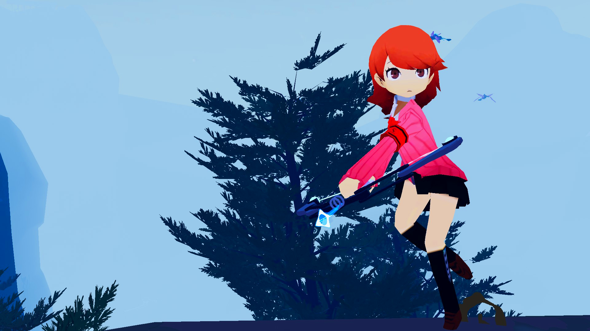
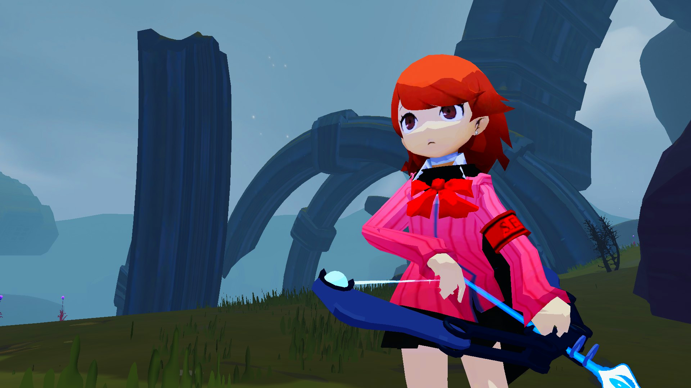
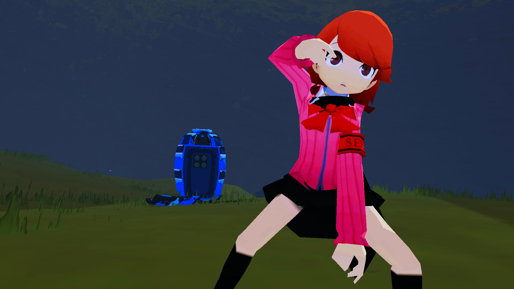
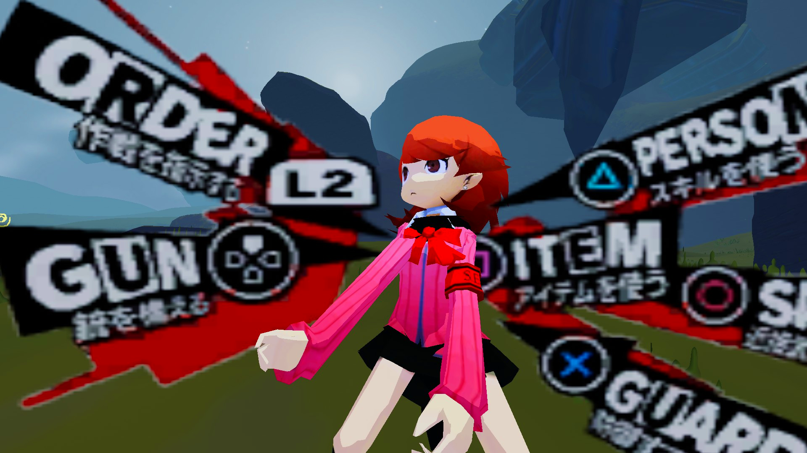

# Jungian Huntress Yukari (ROR2 Persona 3 Mod)

"You really...don't want to go back...?"
No, Yukari. But I gladly went back to Blender to make sure you can look extra adorable in my favourite Roguelike.
Making Yukari into another girl with a longbow was the answer all along.
PLEASE READ RECOMMENDED.

 
 

## Dependencies

* R2API\_Skins
* bbepis-BepInExPack

## RECOMMENDED

* ItemDisplayToggle (To make items not visible on the character body. Items can look weird because the rig is not ready for them.
                               I keep some of the original artstyle by not doing any extreme changes to the body of the character)

 

## Credits and Thanks

* Model: Exported from Persona Q 2 and modified/upscaled/rigged by me.
* SkeletalDelegate for giving me the wonderful idea

 

